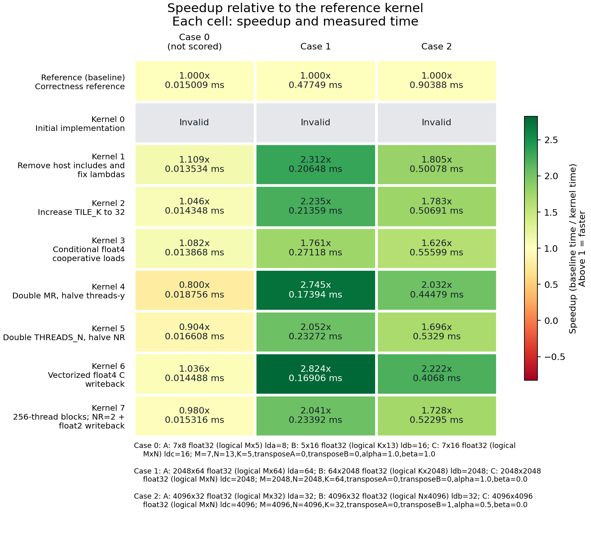
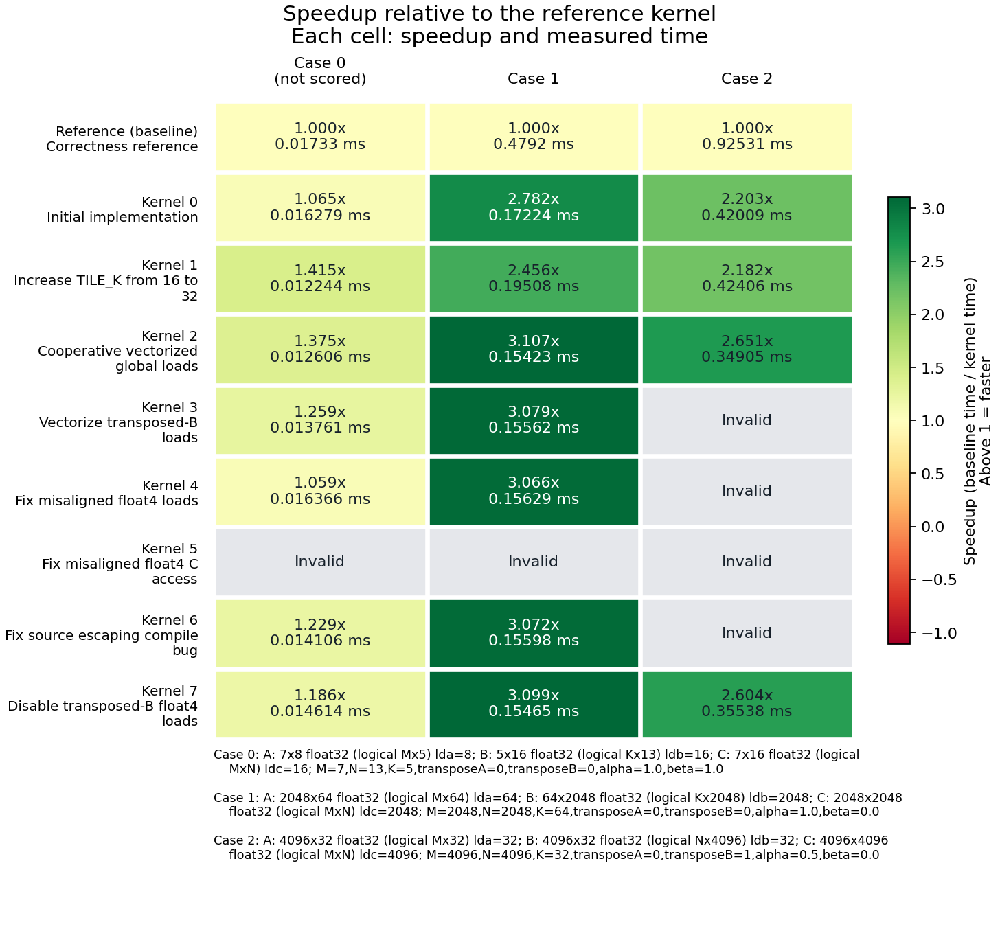
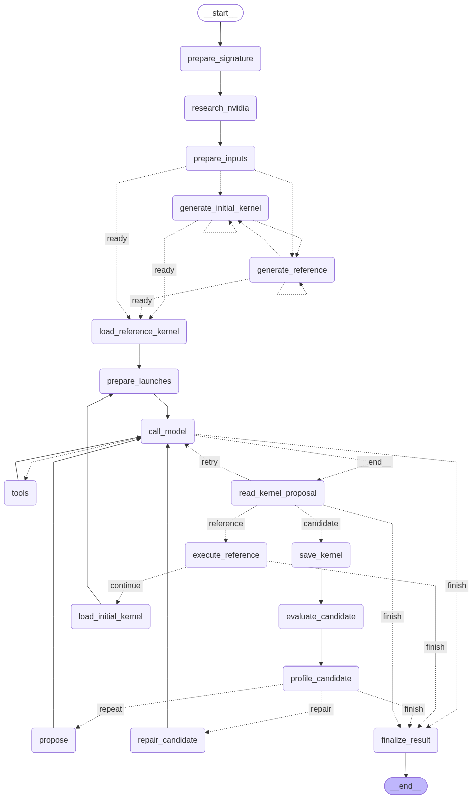

# CUDA Kernel Optimizer

## Contents

- [How it works](#how-it-works)
- [Setup](#setup)
- [Run](#run)
- [Examples](#examples)
- [Results and limits](#results-and-limits)
- [Workflow graph](#workflow-graph)

An agentic CUDA kernel optimizer that turns workload descriptions into GPU implementations through an automated cycle of code generation, correctness checks, benchmarking, and refinement. Powered by LangGraph, the agent explores kernel implementations and launch configurations, queries GPU properties, and can research NVIDIA documentation for optimization guidance and inspect Nsight Compute counters to inform its next experiment. Each experiment is recorded, and the fastest validated implementation is retained.

The model can change both kernel code and per-case launch configurations. A standalone C++ harness compiles kernels with NVRTC, launches them through the CUDA Driver API, and saves outputs. Python handles comparison and candidate selection.

## How it works

1. Load or generate a signature, input cases, reference kernel, and initial kernel.
2. Run the reference and evaluate the initial implementation.
3. Propose a change, compile it, compare outputs with NumPy, and measure kernel latency.
4. Feed results back into the next attempt; repair invalid candidates within the iteration budget.
5. Save the fastest validated candidate, execution history, and a timing heatmap.

Every case must pass validation. Ranking uses the geometric mean of latency across performance cases; small correctness cases do not affect the score. Timing defaults to 10 warmup launches and 100 measured launches using CUDA events. Compilation time and profiler replay timings are excluded from ranking.

## Setup

Developed on Windows with an RTX 3060 Laptop GPU. Requires Python 3.12+, an NVIDIA GPU and compatible CUDA Toolkit/driver, CMake 3.24+, a C++17 compiler, and an OpenAI API key. The build commands below use Visual Studio 2026 with the C++ tools installed.

From the repository root:

```powershell
python -m venv .venv
.venv\Scripts\python -m pip install -r optimizer_agent/requirements.txt
cmake -S cuda_test_harness -B cuda_test_harness/build -DCMAKE_BUILD_TYPE=Release
cmake --build cuda_test_harness/build --parallel
```

Create a `.env` file in the repository root:

```dotenv
OPENAI_API_KEY=your-key-here
```

## Run

```powershell
.venv\Scripts\python optimizer_agent/optimizer_agent.py --description "Single-precision GEMM with rectangular matrices." --max-iterations 7
```

The default model is `gpt-5-mini` with medium reasoning effort. API usage is billed to your account. Use `-h` for all options, or `--config optimizer_agent/example.json` for the included configuration example.

Supply your own workload components with `--signature`, `--reference`, `--initial-kernel`, and `--input-cases`. Omitted components are inferred or generated. To continue from an earlier run using its saved inputs:

```powershell
.venv\Scripts\python optimizer_agent/optimizer_agent.py --description "Single-precision GEMM with rectangular matrices." --input-cases results/run-001/input_cases.json --reference results/run-001/reference.cu --initial-kernel results/run-001/best.cu --max-iterations 7
```

This example assumes the earlier run generated `reference.cu`; supplied references are saved as `supplied-reference.cu`. Input manifests retain paths to their binary data, so keep those files available.

Optional flags:

- `--use-nsight`: profile a performance case after each valid candidate and expose profiler tools to the model. Requires Nsight Compute and permission to access GPU performance counters.
- `--nvidia-research`: retrieve NVIDIA guidance before generating kernels.

## Examples

Float32 GEMM on an RTX 3060 Laptop GPU, with NVIDIA research and Nsight Compute enabled.

| Run 022 | Run 023 |
| --- | --- |
| Optimizing the generated starting kernel. | Continuing from run 022's best kernel with the same inputs and reference. |
| <a href="docs/run-022-heatmap.png"></a> | <a href="docs/run-023-heatmap.png"></a> |

## Results and limits

Each session gets a directory under `results/run-NNN/` containing kernel sources, requests, input/output data, model/tool responses, `history.json`, and `summary.json`. Successful runs export `best.cu`, per-case replay requests, and `heatmap.png`/`heatmap.svg`. Nsight reports are saved when profiling is enabled.

This is an experimental optimizer for individual kernels. Passing supplied cases does not prove general correctness, and a generated reference is not an independent correctness oracle. Improvements are workload-dependent; no comparison against cuBLAS or other vendor libraries is currently included. Keep the GPU otherwise idle when comparing timings.

Generated input scripts execute locally as Python subprocesses without a sandbox. Generated CUDA kernels also run on the local GPU.

## Workflow graph

The graph below is rendered from the compiled LangGraph workflow with Nsight profiling enabled. Dashed edges are conditional routes. Without `--use-nsight`, evaluation routes directly to the next attempt or finalization; NVIDIA research is skipped unless `--nvidia-research` is set.

[](docs/workflow.png)
