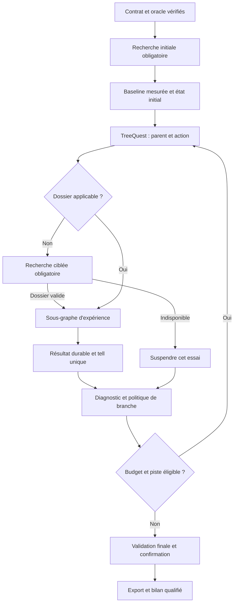
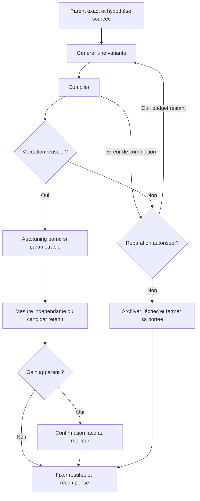

# Spécification — Évolution de CUDA Kernel Optimizer

- **Statut :** spécification d’implémentation proposée ; les évolutions décrites ne sont pas encore implémentées.
- **Version :** 1.0 — 21 octobre 2026.
- **Projet :** [bertaye/agentic-cuda-optimizer](https://github.com/bertaye/agentic-cuda-optimizer).
- **Référence du code analysé :** `1e9464da54dfc651337a97c3643bfeefec712bc1`.
- **Référence TreeQuest étudiée :** `3fac4f8b07e14ed92742471492a59764993b9ab0` ; toute mise à jour devra repasser les tests d’intégration.
- **Origine :** améliorations discutées, corrigées et complétées par les demandes de recherche obligatoire dans les kernels existants, la documentation et le web, ainsi que de maintien de *Programming Massively Parallel Processors*.

Les termes **DOIT**, **DEVRAIT** et **PEUT** désignent respectivement une exigence obligatoire, une recommandation et une extension facultative. Les noms de modules, interfaces et paramètres proposés ci-dessous sont des contrats à développer, sauf lorsqu’ils sont explicitement présentés comme existants.

## 1. Objectif et décisions retenues

L’optimiseur doit produire des kernels corrects, dont le gain est mesuré et confirmé, en explorant plusieurs stratégies dans un budget maîtrisé. Il doit pouvoir revenir à un autre parent, arrêter une piste improductive et reprendre une campagne interrompue.

| ID | Décision obligatoire |
| --- | --- |
| ARCH-01 | **Conserver LangGraph** pour les étapes d’exécution, les transitions, les outils et la reprise. |
| TREE-01 | **Intégrer TreeQuest / AB-MCTS** pour sélectionner le parent et l’action d’une expérience, avec une politique explicite d’éligibilité et de fermeture des branches. |
| RES-01 | Faire du **code CUDA optimisé existant** la principale source d’inspiration : CCCL/CUB, CUTLASS/CuTe et bibliothèques spécialisées pertinentes. |
| RES-02 | Rendre la recherche de code, de documentation et sur le web **obligatoire**, au démarrage et avant chaque nouvelle famille d’optimisations. |
| PMPP-01 | **Conserver et enrichir PMPP** comme cadre de raisonnement permanent et comme source de consultation ciblée. |
| EVAL-01 | Séparer référence de correction, baseline de performance, validation, mesure et promotion du meilleur candidat. |
| TUNE-01 | Confier au LLM les choix de stratégie et à un autotuner l’exploration bornée des paramètres numériques. |
| EXEC-01 | Réduire le coût des essais par un cache de compilation et des workers réutilisables, avec des mesures exclusives par GPU. |
| STATE-01 | Persister l’état LangGraph, l’arbre, les expériences, les budgets et les artefacts ; rendre l’intégration des résultats idempotente. |
| QUALITY-01 | Évaluer l’optimiseur à budgets comparables sur plusieurs familles de kernels, avec mesures répétées et ablations. |

**Correction de périmètre importante :** une mémoire des expériences de sessions passées n’est pas le socle documentaire demandé. Le journal de la campagne reste indispensable pour TreeQuest, la traçabilité, la déduplication et la reprise. Une réutilisation intersessions pourra être ajoutée ensuite ; elle ne remplace jamais les kernels de référence, la documentation, le web ou PMPP.

### 1.1 Périmètre de la première version complète

La première version conserve un contrat d’exécution centré sur **un kernel et sa configuration de lancement**, avec signature, dispositions mémoire et précision définies. Les transformations algorithmiques sont autorisées lorsqu’elles respectent ce contrat. Les sources consultées peuvent utiliser davantage de mécanismes ; leur adaptation doit rester compatible avec le banc de test.

Les pipelines à plusieurs kernels, les allocations supplémentaires et les prétraitements côté CPU constituent une extension distincte. Ils nécessiteraient un nouveau contrat qui chronomètre tout le travail supplémentaire. La réduction de précision ne doit jamais être introduite implicitement pour améliorer le score.

## 2. Point de départ : préserver et renforcer l’existant

| Composant actuel | Comportement observé | Évolution attendue |
| --- | --- | --- |
| [workflow.py][O1] | `StateGraph(OptimizerState)`, boucle modèle/outils et routage des essais ; compilation du graphe sans checkpointer. | Séparer orchestration et recherche, ajouter les gardes documentaires et la persistance durable. |
| [nodes.py][O2] | Le prompt part surtout du meilleur candidat ou du dernier échec ; l’échec conduit à une réparation. | Utiliser exactement le parent TreeQuest, rendre les anciens sources accessibles et borner la réparation. |
| [nodes.py][O2] | Une référence peut être générée par le même modèle ; `make_request()` demande un benchmark, y compris pour les cas de correction. | Vérifier un oracle indépendant et séparer validation courte, validation complète, benchmark et confirmation. |
| [optimization_history.py][O3] | Historique, parent, doublons exacts et agrégation géométrique des temps des cas de performance. | Conserver ces informations, ajouter incertitude, provenance, arbre et décisions de promotion. |
| [Banc CUDA][O4] | CUDA Events, échauffement, répétitions et compilation hors du temps GPU classant. | Conserver ces garanties ; enregistrer les échantillons et confirmer les gains. |
| [use_harness.py][O5] | Nouveau processus par cas et recompilation du source dans le banc. | Cache de compilation, module partagé entre cas compatibles et workers réutilisables. |
| [nvidia_research.py][O6] | Recherche NVIDIA optionnelle au démarrage, puis réutilisation d’une synthèse. | Recherche obligatoire, lecture de code, dossiers versionnés et retours depuis la boucle. |
| [pmpp_guidance.py][O7] | Court guide original inspiré de PMPP. | Le conserver et ajouter des consultations ciblées des contenus réellement disponibles. |
| [nsight_profiler.py][O8] | Profilage facultatif des candidats valides ; sélection automatique d’un cas selon l’empreinte des buffers. | Sélectionner des cas représentatifs et déclencher le profilage selon une question et un budget. |

La validation de toutes les sorties, la comparaison exacte des entiers, les tolérances flottantes, la réinitialisation des buffers et l’export du meilleur valide existent déjà. Elles doivent être préservées. Les améliorations visent notamment leur indépendance, leur couverture et la fiabilité de la décision finale. [Sources : validation][O2], [buffers][O9], [mesures][O4].

## 3. Architecture et responsabilités

**Le graphe LangGraph et l’arbre TreeQuest sont deux structures différentes.** Le premier décrit comment une expérience s’exécute ; le second organise les variantes déjà essayées et les prochains parents/actions à explorer.

| Composant | Responsabilité | Nature |
| --- | --- | --- |
| Orchestrateur LangGraph | Transitions, gardes, sous-graphe d’expérience, erreurs et reprise. | Code déterministe. |
| `SearchPolicy` | Adaptation de TreeQuest, sélection, score, éligibilité, fermeture et persistance de l’arbre. | Code déterministe et algorithme de recherche. |
| Chercheur documentaire | Trouver les kernels pertinents, lire leur code, vérifier CUDA et consulter PMPP. | LLM avec outils de recherche et de lecture. |
| Générateur de candidats | Modifier le parent sélectionné, produire une hypothèse, du code et des paramètres cohérents. | LLM avec réponse structurée. |
| Diagnostic | Interpréter erreurs, mesures et profils ; proposer une recherche ou une transformation. | Analyse déterministe complétée par le LLM. |
| Autotuner | Explorer un domaine de paramètres avec restrictions et sous-budget. | Code classique. |
| Évaluateur CUDA | Compiler, vérifier, mesurer, profiler et fournir les preuves de promotion. | Code indépendant du générateur. |
| Registre d’expériences | Artefacts immuables, résultats, sources, décisions, budgets et reprise. | Stockage durable. |

Ces rôles n’imposent pas un modèle distinct pour chacun. Un même modèle peut remplir plusieurs rôles. Les validations et décisions d’acceptation ne doivent pas dépendre de son seul jugement.

### 3.1 Graphe de campagne



Un essai suspendu faute de recherche ne reçoit pas un faux score d’échec CUDA. Les autres branches possédant un dossier applicable peuvent continuer. Les arrêts globaux doivent conserver le meilleur candidat confirmé et les informations de reprise.

### 3.2 Sous-graphe d’une expérience



Chaque configuration de l’autotuner repasse par compilation si nécessaire, validation et mesure. La boucle est condensée dans le schéma. Les pannes d’infrastructure suivent une récupération bornée distincte de la réparation du code.

## 4. Contrat immuable et oracle indépendant

### 4.1 `WorkloadContract`

Avant l’exploration, le système DOIT figer un contrat versionné contenant :

- Sémantique de l’opération, signature, entrées, sorties et buffers `inout` ; autorisation ou interdiction de modifier chaque entrée.
- Types, formes, strides, dispositions mémoire, alignements, cas limites et transformations autorisées.
- Tolérances absolues et relatives, politique concernant les valeurs non finies et exigences numériques particulières.
- GPU cible, capacité de calcul, limites de ressources, versions pilote/CUDA/compilateur et options de compilation.
- Jeux de validation de recherche, cas de performance, poids, cas critiques et distribution du jeu final.
- Périmètre chronométré, régime de cache, échauffement, estimateur de latence et règle de promotion.

Un changement sémantique, numérique ou du périmètre mesuré crée une nouvelle version du contrat et une campagne distincte. Les scores provenant de contrats différents ne sont pas mélangés.

### 4.2 Trois références distinctes

| Référence | Fonction |
| --- | --- |
| **Oracle de correction** | Déterminer les sorties attendues, indépendamment du candidat optimisé. |
| **Baseline de performance** | Donner un point de comparaison fixe à tous les scores de la campagne. |
| **Meilleur confirmé** | Candidat actuellement retenu, remplacé uniquement après confirmation. |

L’oracle DOIT provenir d’une implémentation fournie et vérifiée, d’une implémentation CPU contrôlée ou d’une bibliothèque reconnue aux conditions numériques équivalentes. Une référence générée par un LLM doit elle-même être confrontée à une source indépendante avant de certifier les candidats. Si cela n’est pas possible, la campagne est marquée `blocked_oracle` et aucune optimisation certifiée n’est annoncée.

Une bibliothèque comme cuBLAS peut également fournir une référence de performance pour une opération compatible. Le rapport doit vérifier types, disposition, précision, transformations nécessaires et périmètre chronométré. Un appel qui réalise davantage ou moins de travail ne constitue pas une comparaison équivalente. Le [profiler CUTLASS][R7] fournit un exemple de comparaison avec des bibliothèques de référence.

### 4.3 Jeux de tests

Le système distingue :

1. **Validation courte** : petit ensemble discriminant, peu de lancements, pour rejeter rapidement les erreurs évidentes.
2. **Validation complète de recherche** : toutes les sorties, formes et cas limites définis pour guider les expériences.
3. **Cas de performance** : cas représentatifs, poids explicites et contraintes sur les régressions.
4. **Jeu final tenu à l’écart** : nouvelles graines et cas conformes à la distribution convenue, accessibles au seul évaluateur final.

Les cas doivent couvrir les queues, dimensions non multiples des tuiles, petites tailles et limites pertinentes pour l’opération. Les graines et générateurs sont enregistrés. Le générateur de candidats ne peut modifier ni l’oracle, ni les tests, ni les seuils.

Pour couvrir de nouvelles formes appartenant au domaine du contrat, chaque candidat DOIT fournir une règle de lancement déterministe, figée et versionnée, qui calcule grille, bloc et mémoire partagée à partir des métadonnées de l’entrée. L’évaluateur l’applique sans rappeler le générateur et enregistre les paramètres obtenus pour chaque cas. Si le contrat impose des formes fixes, le jeu final utilise de nouvelles données et des cas limites dans ces formes ; il ne teste pas implicitement un domaine non pris en charge.

Les cas finaux et leurs réponses ne sont pas transmis aux agents pendant la recherche. Si un échec final est révélé pour reprendre l’optimisation, les cas concernés deviennent des tests de développement et un nouveau jeu final indépendant est requis.

## 5. Recherche obligatoire : code, documentation, web et PMPP

### 5.1 Corpus principal

| Source | Usage attendu | Vérification indispensable |
| --- | --- | --- |
| [NVIDIA CCCL / CUB][R1] | Réduction, scan, tri, coopération entre threads, warps et blocs. | Distinguer primitive utilisable dans le kernel et API qui orchestre plusieurs lancements ou allocations. |
| [NVIDIA CUTLASS / CuTe][R2] | GEMM, convolution, tuilage, disposition des données et pipelines. | Architecture, types, contraintes de lancement, dépendances et compatibilité avec le contrat. |
| [FlashInfer][R3] | Attention, normalisation et opérations d’inférence fusionnées. | Conditions numériques, formes, alignement et code de lancement. |
| [ThunderKittens][R4] | Primitives de tuiles et exemples de kernels matriciels ou d’attention. | Prérequis matériels et adaptation réelle au banc de test. |
| [KernelWiki][R5] | Index de techniques, exemples et modifications amont, orienté Hopper/Blackwell. | Ouvrir les sources originales et contrôler leur version ; ne pas généraliser à toutes les architectures. |
| [Guides CUDA et d’architecture][D1] | Sémantique des API, synchronisation, mémoire et contraintes matérielles. | Consulter les versions correspondant au GPU et à la chaîne de compilation. |
| [PMPP et supports disponibles][P1] | Méthode de décomposition du calcul, localité, parallélisme et compromis. | Identifier les contenus réellement accessibles, leur édition et leur provenance. |

CCCL/CUB et CUTLASS/CuTe forment le socle. Les autres bibliothèques sont sélectionnées selon le workload. Les exemples CUDA pédagogiques peuvent compléter le corpus ; leur présence ne constitue pas une preuve de performance optimale.

Le corpus DOIT conserver le contexte utile : fonction, types, inclusions, configuration de lancement et préconditions. Un découpage en fragments sans relation avec le lanceur est insuffisant. Une recherche textuelle avec filtres et index structurés suffit pour la première version ; une base vectorielle est facultative.

### 5.2 Déclencheurs et garde LangGraph

| Événement | Recherche requise |
| --- | --- |
| Démarrage d’une nouvelle campagne | Recherche dans le code, la documentation, le web et consultation PMPP ciblée. |
| Nouvelle famille d’optimisations | Nouveau dossier ciblé avant génération de son premier candidat. |
| Variante numérique d’une famille documentée | Réutilisation autorisée si les préconditions du dossier restent satisfaites. |
| Résultat inexpliqué, stagnation ou hypothèse techniquement non étayée | Nouvelle recherche liée aux mesures, erreurs ou profils observés. |
| GPU, contrat numérique ou chaîne de compilation modifiés | Invalidation des dossiers incompatibles et nouvelle campagne si le contrat change. |

La garde `research_ready` DOIT vérifier le contenu et l’applicabilité du dossier. Un simple booléen fourni par le modèle est insuffisant. Le chemin de génération n’est accessible qu’après cette garde.

La famille d’optimisation est définie avant la garde, même lorsque l’action sélectionne un modèle ou un prompt. La proposition doit rester dans cette famille et respecter les préconditions du dossier. Si elle introduit une technique non couverte, elle est marquée `needs_research` et n’est pas exécutée ; le graphe retourne à la recherche puis à une proposition appuyée sur le nouveau dossier.

La recherche web est une vraie étape d’exécution : requêtes enregistrées, pages ouvertes et sources lues. Un résultat de moteur de recherche seul ne suffit pas. Les domaines prioritaires sont la documentation officielle, les dépôts des auteurs et leurs discussions techniques. Le cache documentaire évite les téléchargements redondants, mais ne remplace pas la recherche ciblée obligatoire d’une nouvelle famille.

Les délais, quotas et tentatives sont bornés. Une indisponibilité crée `research_blocked` ou suspend l’essai concerné ; elle ne désactive pas silencieusement l’exigence. Une recherche qui ne trouve aucun exemple applicable peut se terminer par un constat négatif documenté et une hypothèse originale explicitement identifiée, avec contraintes CUDA vérifiées.

### 5.3 Dossier de recherche

Un `ResearchDossier` DOIT contenir au minimum :

```text
research_id, workload_hash, strategy_family, environment_fingerprint
queries, retrieval_status, retrieved_at
sources[]: kind, URL, repository, commit_or_version, file, symbol,
           section_or_locator, provenance, license_if_code_reused
reference_kernels[], launch_requirements, dependencies
applicability_checks, incompatible_conditions, missing_evidence
pmpp_topics[], hypotheses[], expected_effects[], validation_metrics[]
```

Chaque hypothèse distingue **fait documenté**, **propriété observée dans le code** et **effet attendu à mesurer**. Une performance publiée ailleurs n’est pas considérée acquise sur le GPU cible.

### 5.4 Maintien et enrichissement de PMPP

Le contenu de [pmpp_guidance.py][O7] DOIT rester dans le contexte des étapes de diagnostic et de proposition. Il s’agit d’un guide original inspiré du livre ; le dépôt ne fournit pas un index de son texte intégral.

Un catalogue thématique complémentaire DOIT permettre la consultation de fiches sourcées, supports officiels et sections effectivement disponibles : coalescence, tuilage, réutilisation dans les registres, occupation et parallélisme, divergence, synchronisation, réduction, scan, stencil et convolution. Le [site compagnon de la quatrième édition][P2] constitue une source possible de supports pédagogiques.

Chaque résultat PMPP indique édition et provenance. Le système ne doit pas inventer de citation, de numéro de page ou de chapitre non consulté. Les principes PMPP guident le raisonnement ; les contraintes propres à une API ou à un GPU sont vérifiées dans la documentation CUDA correspondante.

Une proposition DOIT relier **principe PMPP → implémentation consultée → contrainte CUDA → transformation → mesure attendue**. Exemple : améliorer la réutilisation d’un stencil par tuilage, en vérifiant le coût des halos, les barrières et la mémoire partagée, puis comparer les variantes sur les cas du contrat.

Lorsqu’aucune implémentation applicable n’est trouvée, le constat négatif documenté remplace ce maillon : exemples rejetés et incompatibilités sont conservés, et l’hypothèse originale reste reliée à PMPP et aux contraintes CUDA vérifiées.

## 6. TreeQuest et politique d’exploration

### 6.1 Interface et parent sélectionné

L’intégration DOIT utiliser le découplage `ask` / `tell` de TreeQuest. `ask_batch` peut préparer plusieurs essais, mais leur exécution reste à la charge de l’application. Les actions peuvent désigner des stratégies, prompts ou modèles ; plusieurs modèles ne sont pas requis. [API et fonctionnement TreeQuest][T1].

Le backend initial retenu est **AB-MCTS-A**, derrière une interface applicative `SearchPolicy`. Le générateur reçoit le source et les paramètres exacts du `trial.parent_state`. Le meilleur global n’est jamais substitué implicitement au parent sélectionné. Le parent virtuel initial correspond à la baseline vérifiée.

Ajouter l’outil en lecture seule `get_candidate_source(candidate_id)`, avec accès au source, aux paramètres, aux mesures et aux références associés. Une variante valide mais plus lente peut rester un parent intéressant ; elle n’est pas supprimée automatiquement.

### 6.2 Fermeture réelle et réparations bornées

Un score faible, une réparation, une fermeture et l’arrêt de la campagne sont quatre événements distincts.

- Une erreur du candidat autorise un nombre borné de réparations locales ; valeur de départ proposée : **deux réparations**.
- Lorsque ce budget est épuisé, le candidat invalide devient inéligible comme parent. L’échec ne ferme pas automatiquement son parent valide ni les autres stratégies.
- Une branche ou un couple parent/action peut être suspendu ou fermé pour budget épuisé, précondition impossible ou stagnation définie par la politique.
- La portée doit être explicite : `candidate`, `parent_action`, `subtree` ou `strategy_family`. La dernière ne doit pas être inférée d’un seul échec local.
- La décision conserve motif, preuves, auteur de la règle, horodatage et compteurs. Une fermeture n’efface pas les résultats et n’invalide pas un descendant correct déjà obtenu.

**Limite d’intégration à traiter :** l’API publique examinée n’expose pas de `close_branch()` ni de masque d’actions propre à chaque parent. Le projet DOIT livrer une extension maintenue de la sélection TreeQuest, versionnée, qui applique l’éligibilité avant création d’un essai. Une boucle qui appelle `ask()` puis rejette indéfiniment les parents fermés n’est pas acceptable. L’éligibilité est contrôlée à nouveau avant lancement. [Structures et sélection][T2].

`TrialStatus.INVALID` concerne l’ordonnancement d’essais devenus inapplicables ; il ne signifie pas « kernel CUDA incorrect ». Un score nul ne ferme pas une branche. [Statuts TreeQuest][T4].

AB-MCTS-M pourra être proposé derrière la même interface. Son pruning de stagnation repose notamment sur des scores arrondis au centième, au moins quatre observations et une proportion par défaut de 75 % de scores identiques. Cette heuristique est distincte de la fermeture métier et peut masquer de petits gains CUDA. Elle reste désactivée par défaut tant qu’elle n’est pas calibrée sur ces gains. [Implémentation du pruning][T3].

### 6.3 Score stationnaire

Pour les cas de performance de recherche, fixer des poids positifs `w_i`, de somme 1. Avec `b_i` la latence de baseline figée et `t_i` la latence du candidat selon le même estimateur :

```text
gain = exp(sum_i(w_i * log(b_i / t_i)))
reward = gain / (1 + gain)       # candidat valide
reward = 0                     # candidat incorrect après réparations
```

Cette transformation est une décision proposée pour l’intégration : monotone, bornée dans `[0, 1]`, avec baseline à `0,5`. Les latences doivent être strictement positives et valides. Les poids, baseline et formule restent figés pendant la campagne. Le gain relatif au parent est conservé à titre diagnostique, mais ne sert pas de score global.

Les erreurs d’infrastructure ne reçoivent pas automatiquement `0`. Elles sont réessayées dans leur budget, puis suspendues ou annulées sans observation de performance, via l’adaptateur à développer.

La récompense d’un essai est publiée **une seule fois**, après le protocole prévu, y compris la confirmation lorsqu’elle est déclenchée. `tell()` étant idempotent, un second appel ne constitue pas une mise à jour de score. Les remesures ultérieures sont des observations distinctes dans le registre. Le résultat final est choisi parmi les candidats admissibles et revalidés, jamais par `top_k()` seul. [API TreeQuest][T1].

Le registre désigne explicitement l’évaluation `tree_reward` utilisée pour calculer cette récompense : mesure nouvelle du résultat local retenu, sur les cas de recherche et selon le protocole figé. Les mesures de confirmation face au meilleur restent distinctes. Une découverte ultérieure d’erreur met à jour la validité et l’éligibilité du candidat sans tenter de réécrire une récompense déjà intégrée.

### 6.4 Un essai TreeQuest et ses variantes locales

Un essai choisit un parent et une transformation, puis peut contenir des réparations et un sous-budget d’autotuning. Tous les intermédiaires sont archivés. **Un seul résultat représentatif** est intégré à TreeQuest : le candidat local retenu, remesuré indépendamment, ou un résultat d’échec.

Les configurations locales ne sont pas simultanément ajoutées comme observations indépendantes de la même récompense. Cette règle évite de compter plusieurs fois le même essai. Le nombre d’évaluations, le coût et le protocole de sélection locale restent visibles pour comparer les actions équitablement.

## 7. Validation, mesure et promotion

### 7.1 Parcours obligatoire

L’ordre normal est **compilation → validation courte → validation complète de recherche → benchmark → confirmation éventuelle**. Un candidat incorrect ne consomme pas le benchmark complet.

L’évaluateur DOIT :

- Comparer toutes les sorties et appliquer le contrat numérique figé ; conserver les comparaisons exactes pour les entiers.
- Réinitialiser les entrées et buffers `inout` entre lancements conformément au contrat.
- Détecter les écritures manquantes avec des sentinelles adaptées lorsque la sémantique le permet ; ne pas modifier ainsi un accumulateur dont l’état initial fait partie du calcul.
- Vérifier que les entrées déclarées en lecture seule ne sont pas modifiées.
- Répéter des vérifications de correction pour les transformations susceptibles d’introduire une course ou un comportement non déterministe.
- Classer distinctement erreur de compilation du candidat, erreur numérique, erreur mémoire, échec d’infrastructure et indisponibilité d’un outil.

Des passages ciblés avec [Compute Sanitizer][D4] DOIVENT être prévus pour les transformations pertinentes et les finalistes : `memcheck` pour les accès invalides, `racecheck` pour les dangers de concurrence en mémoire partagée, `initcheck` pour les lectures de mémoire globale non initialisée et `synccheck` pour les usages incorrects de synchronisation. Leur périmètre ne doit pas être présenté comme une preuve générale d’absence de bogue. Les temps instrumentés ne participent jamais au score.

Le contrat indique les contrôles instrumentés requis et ceux qui ne sont pas applicables. L’indisponibilité d’un contrôle requis bloque la certification correspondante ; elle ne devient pas un succès implicite.

### 7.2 Protocole de mesure

Conserver les CUDA Events, les synchronisations utiles, l’échauffement et l’exclusion des transferts et de la compilation lorsque le contrat porte uniquement sur le kernel. [Banc actuel][O4].

Chaque mesure DOIT enregistrer les temps élémentaires ou les séries brutes, leur regroupement, l’échauffement, les répétitions, l’ordre des candidats, les métadonnées GPU et les incidents. Le régime de cache et la réinitialisation des données doivent être identiques entre candidats comparés.

L’estimateur par défaut proposé est la **médiane des moyennes de séries**. Il est figé dans le contrat, avec le nombre de séries et de lancements. Une autre fonction objectif, notamment le temps moyen d’une distribution réelle, peut être choisie avant la recherche. Les métriques par cas restent visibles à côté du score agrégé ; les poids reflètent le workload attendu ou sont explicitement uniformes.

### 7.3 Confirmation d’une amélioration

Un candidat apparemment meilleur est confronté au meilleur confirmé sur le même GPU, par séries appariées dont l’ordre A/B est alterné ou randomisé. Chaque série réinitialise les conditions prévues. L’incertitude est estimée au niveau des séries, en préservant les paires ; les lancements consécutifs d’une même série ne sont pas traités artificiellement comme autant de mesures indépendantes.

Le protocole par défaut utilise un nombre de séries fixé à l’avance et une seule décision en fin de confirmation. La méthode d’intervalle, son niveau et le gain minimal utile sont configurés et enregistrés. Un bootstrap apparié des séries est une implémentation possible ; il fournit une estimation d’incertitude, pas une garantie universelle.

| Décision | Condition et effet |
| --- | --- |
| `promoted` | Correction valide, borne inférieure du gain supérieure au gain minimal utile, et contraintes des cas critiques respectées. Remplacer le meilleur confirmé. |
| `not_improved` | Absence de gain ou régression incompatible. Archiver et continuer l’exploration selon TreeQuest. |
| `inconclusive` | Les mesures ne permettent pas de conclure. Conserver le meilleur confirmé. |

Précisément, si `G` est l’accélération géométrique pondérée du candidat face au meilleur comparé, la condition de gain est `borne_inferieure(G) > 1 + min_relative_gain`. Elle s’ajoute aux contraintes par cas. Le score TreeQuest, lui, demeure calculé face à la baseline fixe.

Les remesures doivent être bornées. Autoriser plusieurs décisions successives exige un protocole séquentiel défini à l’avance ; répéter jusqu’à obtenir une victoire est interdit. Aucun seuil fixe, par exemple 1 %, n’est présenté comme universellement suffisant.

La promotion est atomique et vérifie la version du meilleur utilisé pour la comparaison. Si un autre essai a promu un nouveau meilleur entre-temps, le résultat ne peut pas l’écraser sans comparaison applicable.

### 7.4 Certification finale

À la fin, utiliser le budget réservé pour vérifier l’artefact exact retenu sur le jeu final. Confirmer son gain face à la baseline avec de nouveaux échantillons pour les deux, selon le périmètre, les cas de performance et l’agrégation annoncés. Les empreintes du code, des options, de la règle de lancement et des paramètres effectifs doivent correspondre à celles exportées.

Une erreur de correction finale produit `final_validation_failed`. Si la correction réussit mais que le gain n’est pas confirmé, l’artefact est qualifié de valide avec gain non certifié. Une finalisation interrompue ou sans budget suffisant reste `finalization_incomplete`. Le meilleur confirmé et les diagnostics sont conservés sans certification implicite. Une reprise après exposition des tests suit la règle du nouveau jeu final de la section 4.3. La baseline peut être restituée avec le statut `validated_no_gain` seulement après sa validation finale applicable.

## 8. Autotuning des paramètres

Le LLM produit une stratégie, un source paramétrable et un domaine contraint : taille de bloc, dimensions des tuiles, travail par thread, vectorisation, déroulage et nombre d’étages lorsque ces paramètres sont applicables.

L’autotuner DOIT :

1. Vérifier les dépendances entre paramètres du code et configuration de lancement.
2. Filtrer les incompatibilités déterminables avant exécution : limites matérielles, alignement, divisibilité requise, mémoire partagée et combinaisons interdites.
3. Compiler et valider chaque configuration concrète, puis mesurer uniquement les configurations correctes.
4. Respecter un sous-budget par essai ainsi que les budgets globaux ; les compilations et configurations invalides sont comptabilisées.
5. Remesurer le meilleur résultat local sur des séries nouvelles avant de l’utiliser comme observation TreeQuest ou de le proposer à la promotion.

L’adaptateur pourra employer [Kernel Tuner][R6], dont l’API propose paramètres, restrictions, vérification et limites de recherche. La première implémentation DOIT conserver l’évaluateur et le contrat communs : intégrer une bibliothèque ne crée pas un second chemin de validation moins strict.

Les paramètres sont stockés avec le source et le lancement exacts. Un même source avec deux configurations différentes forme deux candidats exécutables distincts. Une remesure intentionnelle d’un candidat existant reçoit un nouvel identifiant de mesure ; elle ne doit pas être supprimée comme doublon.

## 9. Banc d’essai, cache et parallélisme

### 9.1 Compilation et workers

Le cache de compilation est indexé par le contenu du source, des dépendances, des options, la cible GPU, les versions du compilateur/toolkit et les éléments d’ABI pertinents. Le cache n’est valide que si tous ces éléments concordent.

Les capacités admissibles sont celles effectivement exposées par le banc de test. Une limite matérielle théorique, notamment de mémoire partagée nécessitant un attribut de lancement supplémentaire, n’est pas utilisable tant que le worker ne configure pas cet attribut et ne le conserve pas dans les paramètres évalués.

Un module compilé peut servir à plusieurs cas compatibles. Un worker persistant peut réutiliser contexte et allocations, à condition de maintenir les réinitialisations et l’isolation des expériences. Après une erreur CUDA qui compromet le contexte, le worker est arrêté et remplacé.

Le cache de mesures est distinct. Il peut éviter une expérience strictement redondante dans le même contexte, mais ne remplace jamais silencieusement une confirmation ou une mesure finale exigeant de nouveaux échantillons.

Une mesure réutilisée conserve son `evaluation_id`. Deux essais ne peuvent pas la présenter comme deux observations indépendantes à TreeQuest. Un doublon rejoint l’essai identique déjà en cours, ou son essai de recherche est annulé comme doublon avec un lien vers le résultat existant. Une nouvelle observation requiert une remesure intentionnelle et indépendante ; l’adaptateur résout les essais annulés sans inventer de récompense.

### 9.2 Ordonnancement

Les recherches documentaires, appels au modèle et compilations compatibles peuvent s’exécuter en parallèle dans des espaces de travail séparés. Les sources parents sont immuables.

Les validations, benchmarks et profils utilisent une file réservant le GPU. **Deux mesures comparables ne s’exécutent pas simultanément sur le même GPU.** L’ordonnanceur tient compte d’un éventuel modèle local ou de tout autre travail CUDA utilisant ce GPU ; en cas d’interférence observée, les mesures sont invalidées ou replanifiées.

Plusieurs GPU peuvent exécuter des campagnes ou partitions compatibles. Les scores de GPU différents ne sont pas mélangés dans un même classement sans contrat explicitement prévu pour cela. La taille des lots TreeQuest reste bornée pour recevoir régulièrement le retour des expériences.

### 9.3 Profilage utile et proportionné

Nsight Compute reste un outil de diagnostic conditionnel, avec son propre budget. Une demande de profil indique la question à résoudre et les métriques attendues. Le choix du cas repose sur sa représentativité ; plusieurs formes peuvent nécessiter plusieurs profils.

Les compteurs cités par le modèle doivent être reliés à un résultat réellement mesuré. Les données de compilation disponibles — registres, spills, mémoire partagée — complètent le diagnostic. La politique de cache, le rejeu et les conditions de profilage sont enregistrés. Les temps de profilage ne remplacent pas le benchmark. Les limites de disponibilité ou de permissions sont consignées sans tentatives répétées indéfiniment. [Nsight Compute][D3].

## 10. Modèle de données et interfaces

### 10.1 Identités et objets

| Objet | Champs minimaux |
| --- | --- |
| `Campaign` | `run_id`, version du contrat, empreinte d’environnement, versions logicielles, état, compteurs et réservations de budget. |
| `Candidate` | `candidate_id`, `trial_id`, parent choisi par TreeQuest, parent source effectif, famille, hypothèse, sources, code/hash, paramètres, règle de lancement figée, lancements par cas, validité. |
| `Trial` | `trial_id`, parent, action, dossier documentaire, candidats locaux, état d’ordonnancement, résultat représentatif, récompense figée. |
| `Evaluation` | `evaluation_id`, `attempt_id`, candidat, cas/graines, protocole, temps bruts, correction, diagnostics, environnement et erreurs typées. |
| `BranchDecision` | Cible et portée, état `active/suspended/closed`, motif, preuves, budgets et date. |
| `Promotion` | Candidat, meilleur comparé et sa version, évaluations nouvelles, décision, intervalle et seuils. |
| `ResearchDossier` | Schéma défini en section 5.3, sources et conditions de réutilisation. |

Le parent source effectif conserve la chaîne des réparations et variantes locales. Le parent TreeQuest conserve la filiation de l’expérience globale. Cette distinction rend l’autotuning et les réparations auditables.

La validité numérique, le score de recherche, l’éligibilité à une expansion et la certification finale sont des champs distincts. Un statut d’ordonnancement ne les remplace pas.

### 10.2 Interfaces applicatives à développer

```python
# Contrats conceptuels du projet : ces méthodes ne sont pas une API TreeQuest native.
SearchPolicy.ask(eligible_actions, budget_reservation) -> Trial
SearchPolicy.tell_once(trial_id, result, reward) -> None
SearchPolicy.close(scope, target_id, reason) -> None
SearchPolicy.suspend_or_cancel(trial_id, reason) -> None
ResearchService.prepare(workload, parent, action, evidence) -> ResearchDossier
CandidateGenerator.propose(parent, action, dossier, pmpp_context) -> Proposal
Evaluator.validate(candidate, suite) -> ValidationResult
Evaluator.benchmark(candidate, protocol) -> MeasurementResult
Evaluator.confirm(candidate, incumbent, protocol) -> PromotionDecision
Autotuner.search(candidate_template, parameter_space, budget) -> LocalSearchResult
```

La proposition structurée contient au minimum parent, hypothèse, principe PMPP, références, modification, compromis, source, paramètres et critères de vérification. Les sorties sont validées avant exécution. Les outils documentaires exposent recherche, lecture de code, consultation de documentation et consultation PMPP ; les outils d’historique restent en lecture seule pour le générateur.

## 11. Persistance, reprise et budgets

### 11.1 État durable

Ajouter un checkpointer LangGraph persistant avec `thread_id` stable. SQLite convient à une première installation locale ; PostgreSQL peut servir au déploiement distribué. Le checkpointer conserve l’état du graphe ; le registre d’expériences conserve les artefacts et résultats. Cette séparation suit celle entre checkpoints et données persistantes applicatives. [Persistance LangGraph][L1].

Persister également l’arbre TreeQuest, sa version, son état aléatoire, les essais en attente, les décisions de fermeture et les budgets. Le stockage d’un seul historique de messages ne suffit pas.

### 11.2 Idempotence

L’effet durable d’une intégration de résultat DOIT être unique. L’exécution physique d’un kernel peut être répétée après une interruption ; le système ne prétend pas garantir un lancement exactement une fois.

Le cycle est le suivant : réserver le budget et persister l’essai sélectionné ; lancer le travail ; enregistrer le résultat validé et un événement à intégrer ; appliquer `tell` sous un unique écrivain ; enregistrer la nouvelle version d’arbre et l’événement traité. Une transaction ou un journal transactionnel permet de reprendre une interruption entre ces étapes.

Toutes les mutations de l’arbre — `ask`/`ask_batch`, `tell`, fermetures et changements d’éligibilité — sont sérialisées ou transactionnelles. L’arbre mis à jour par `ask`, les essais en attente et leurs réservations sont persistés atomiquement avant lancement. La reprise couvre aussi une interruption après application en mémoire de `tell` mais avant validation durable de l’arbre et de l’événement traité.

À la reprise :

- Un résultat complet et validé est réutilisé, sans nouveau nœud ni double récompense.
- Une tentative interrompue dont le résultat est incertain est relancée avec un nouvel `attempt_id` et son coût reste visible.
- Un résultat tardif peut être archivé, mais ne rouvre pas automatiquement sa branche.
- Un changement incompatible de contrat, d’environnement ou de protocole bloque la fusion des mesures et demande une nouvelle campagne.

Les chemins d’artefacts dépendent d’identifiants stables. Les écritures utilisent des fichiers temporaires et une validation atomique. Le comportement actuel d’ouverture exclusive des fichiers de résultat ne doit pas provoquer un échec systématique lors d’une reprise. [Appel actuel du banc][O5].

### 11.3 Budgets

Les limites couvrent temps total, réservation GPU, essais TreeQuest, configurations locales, réparations, compilations, recherches, appels/tokens modèle et coût si disponible. Chaque tâche réserve son budget avant lancement puis le réconcilie avec sa consommation réelle. Les tâches concurrentes ne doivent pas toutes considérer le même solde comme disponible.

Le coût GPU inclut les validations, échauffements, benchmarks, confirmations et profils ; il ne se réduit pas au temps du kernel utilisé pour le classement. Un budget de finalisation est réservé dès le départ. L’épuisement du budget de réparation d’un essai ne termine pas toute la campagne.

Chaque étape possède un timeout. L’exécution CUDA est supervisée hors du worker pour traiter notamment un kernel bloqué. Un worker non réactif est arrêté ou isolé ; le GPU n’est réattribué qu’après vérification de sa disponibilité. Les réservations interrompues sont réconciliées ou expirent selon une règle persistée, sans libérer fictivement un GPU encore occupé.

Le résultat final distingue `termination_reason` — objectif atteint, budget, absence de piste, interruption, recherche bloquée ou infrastructure — de `certification_status` — certifié, sans gain, non certifié ou échec final. Un arrêt anticipé doit préserver les artefacts et indiquer précisément les étapes effectuées.

## 12. Configuration proposée

L’exemple suivant définit un format à implémenter. Les nombres sont des valeurs de départ pour une campagne de développement ; ils ne constituent pas des réglages optimaux ou des garanties statistiques.

```yaml
schema_version: 1
search:
  backend: treequest_ab_mcts_a
  max_pending_trials: 3
  max_trials: 40
  max_repairs_per_trial: 2
  eligibility_extension: required
  ab_mcts_m_pruning: false
research:
  required: true
  refresh_on: [startup, new_strategy_family, unexplained_result, stagnation]
  sources: [cccl, cutlass, flashinfer, thunderkittens, kernelwiki, cuda_docs]
  web_search: required
  max_search_calls_per_dossier: 6
  pmpp:
    permanent_guidance: true
    targeted_retrieval: true
    require_provenance: true
measurement:
  per_case_estimator: median_of_batch_means
  aggregation: weighted_geometric_speedup
  confirmation_batches: 20
  confirmation_decisions: 1
  interval_method: paired_batch_bootstrap
  confidence_level: 0.95
  min_relative_gain: 0.01
  exclusive_gpu: true
autotuning:
  enabled: true
  max_configurations_per_trial: 12
  independent_winner_remeasurement: true
persistence:
  checkpoint_backend: sqlite
  transactional_trial_ledger: true
budgets:
  wall_time_seconds: 7200
  gpu_lease_seconds: 1800
  model_tokens: 200000
  finalization_reserve_fraction: 0.15
```

Les poids des cas, contraintes de régression, échauffements et répétitions appartiennent au contrat du workload et doivent être renseignés avant lancement. En mode normal, `research.required: false` ou l’absence de recherche web sont rejetés. Les tests et ablations peuvent utiliser des sources simulées ou désactiver un composant sous un mode expérimental explicite, jamais en annonçant une campagne conforme à cette spécification.

## 13. Sorties et observabilité

Chaque campagne DOIT produire :

- Un manifeste : contrat, versions, GPU, configuration, budgets, statuts et raison de terminaison.
- Le source du candidat retenu et ses paramètres de lancement exacts ; la baseline est conservée.
- Un manifeste de validation finale et de confirmation, avec empreintes des artefacts.
- Les candidats, filiations, hypothèses, dossiers de recherche et références consultées.
- Les évaluations, temps bruts, profils et décisions de promotion.
- L’arbre de recherche et les motifs d’abandon ou de suspension.
- Un bilan lisible : gains par cas et agrégés, incertitude, régressions, coût et limites restantes.

Les sorties actuelles utiles, notamment `best.cu`, configurations de lancement, historique et visualisation, doivent être conservées ou migrées explicitement. Si la certification n’a pas abouti, les fichiers du meilleur connu restent disponibles avec un nom ou un manifeste qui indique ce statut ; ils ne sont pas présentés comme un résultat certifié.

Les événements structurés incluent au minimum sélection, recherche, génération, compilation, validation, mesure, promotion, fermeture, checkpoint et reprise. Les erreurs sont reliées à leurs identifiants. Le bilan doit permettre de reconstruire une expérience à partir de ses artefacts, sans dépendre d’un résumé du modèle.

## 14. Plan de modification du code

Les chemins ci-dessous désignent le dépôt cible. Les nouveaux noms sont proposés pour isoler les responsabilités sans refonte inutile des interfaces existantes.

| Fichier ou module | Modification attendue |
| --- | --- |
| `optimizer_agent/workflow.py` | Introduire le graphe de campagne et le sous-graphe d’expérience ; ajouter gardes, sélection et checkpointer. |
| `optimizer_agent/nodes.py` | Extraire validation, benchmark et confirmation ; remplacer le choix implicite du parent et le routage réparation/continuation. |
| `optimizer_agent/kernel_proposal.py` | Étendre la proposition structurée : parent exact, références, hypothèse, paramètres et contraintes. |
| `optimizer_agent/state.py` | Stocker les identifiants durables, dossiers, budgets et versions ; éviter de dupliquer les gros artefacts dans chaque checkpoint. |
| `optimizer_agent/agent_tools.py` | Ajouter lecture des candidats, recherche de code, lecture documentaire et consultation PMPP. |
| `optimizer_agent/nvidia_research.py` | Migrer vers un service de recherche obligatoire et réentrant, avec sources de code et dossiers applicables. |
| `optimizer_agent/pmpp_guidance.py` | Conserver le guide actuel et le relier au catalogue thématique sourcé. |
| `optimizer_agent/input_generation.py` | Séparer tests de recherche et jeu final ; enregistrer graines et générateurs sous contrôle de l’évaluateur. |
| `optimizer_agent/optimization_history.py` | Ajouter filiations, variantes locales, mesures multiples, provenance et décisions de promotion. |
| `optimizer_agent/use_harness.py` | Introduire un client de worker, les identifiants d’exécution et les écritures compatibles avec la reprise. |
| `cuda_test_harness/harness.cpp` | Séparer modes validation/mesure, réutiliser les modules et restituer les échantillons. |
| `cuda_test_harness/kernel_request.h` et `run_record.h` | Formaliser les données de contrôle, métadonnées, vérifications et résultats détaillés. |
| `optimizer_agent/nsight_profiler.py` | Déclenchements ciblés, sélection de cas et réservation GPU commune. |
| `optimizer_agent/optimizer_config.py` et entrée CLI | Configuration validée, reprise par `run_id`, budgets et statut de résultat. |
| Nouveaux modules `search_policy.py`, `treequest_eligibility.py` | Adaptateur TreeQuest, extension d’éligibilité, fermeture et intégration unique des récompenses. |
| Nouveaux modules `evaluation.py`, `autotuning.py`, `research_service.py` | Contrats distincts d’évaluation, réglage des paramètres et recherche documentaire. |
| Nouveaux modules `experiment_store.py`, `gpu_scheduler.py`, `compile_cache.py` | Registre durable, coordination des ressources et cache. |

L’intégration TreeQuest DOIT être isolée derrière l’adaptateur. Son extension maintenue doit documenter les modifications apportées au comportement amont et être testée contre la version fixée. Il ne suffit pas d’ajouter la dépendance à `requirements.txt`.

## 15. Critères d’acceptation fonctionnels

| Test | Scénario | Résultat exigé |
| --- | --- | --- |
| AC-01 | Génération demandée sans dossier applicable. | Garde bloquante et recherche déclenchée ; aucun candidat n’est généré en contournant l’exigence. |
| AC-02 | Nouvelle famille, ajustement compatible, puis technique non couverte introduite dans une proposition. | Recherche effective pour la famille, réutilisation autorisée pour l’ajustement ; proposition non couverte bloquée et renvoyée à la recherche. |
| AC-03 | Recherche web indisponible ou sans exemple pertinent. | Panne et recherche négative distinguées ; aucun faux succès, aucune citation inventée. |
| AC-04 | Consultation PMPP avec uniquement le guide et les supports installés. | Provenance exacte ; aucun accès fictif au livre intégral ; principes présents dans le diagnostic et la proposition. |
| AC-05 | TreeQuest sélectionne un candidat moins rapide que le meilleur global. | Le générateur reçoit exactement son source et ses paramètres. |
| AC-06 | Réparations épuisées et fermeture d’un parent/action ou sous-arbre. | Aucune nouvelle expansion interdite, même en lot ; les autres pistes continuent ; les résultats restent consultables. |
| AC-07 | Deux branches obtiennent les mêmes temps avec des parents différents. | Même score global ; les petits gains restent distinguables. |
| AC-08 | Résultat incorrect, sortie partiellement écrite ou entrée modifiée illicitement. | Rejet sur les cas de contrôle adaptés ; pas de benchmark complet ni d’export certifié. |
| AC-09 | Changement de précision, tolérance ou périmètre par le candidat. | Rejet au titre du contrat, indépendamment du gain apparent. |
| AC-10 | Gain inférieur au bruit ou régression d’un cas critique. | Meilleur confirmé conservé ; décision et mesures enregistrées. |
| AC-11 | Gain reproductible satisfaisant la règle fixée. | Promotion atomique avec preuves, puis certification finale de l’artefact exact. |
| AC-12 | Autotuning avec configurations invalides et candidat gagnant. | Restrictions appliquées, chaque configuration validée, coûts comptés et gagnant remesuré indépendamment. |
| AC-13 | Même compilation, puis modification d’une dépendance ou option. | Réutilisation dans le premier cas, invalidation du cache dans le second. |
| AC-14 | Deux benchmarks ou un benchmark et un profil demandent le même GPU. | Exécution exclusive ; aucune comparaison contaminée par leur concurrence. |
| AC-15 | Worker avec contexte CUDA compromis. | Arrêt et remplacement avant toute mesure acceptée suivante. |
| AC-16 | Interruption après résultat durable avant `tell`, puis après `tell` avant persistance de l’arbre. | Reprise sans double nœud, double score ni double consommation validée ; essais en attente également restaurés. |
| AC-17 | `trial_id` répété, deux essais pointant vers la même mesure cachée, puis remesure intentionnelle. | Une intégration par preuve ; doublon fusionné ou annulé ; remesure distincte, sans second `tell` correctif. |
| AC-18 | Budget global épuisé, panne d’outil ou changement de matériel à la reprise. | Arrêt qualifié ou reprise compatible ; meilleur préservé ; scores incompatibles non mélangés. |
| AC-19 | Nouvelle forme admissible, puis échec sur le jeu final. | Lancement calculé par la règle figée sans rappel du modèle ; échec explicite, sans boucle de génération alimentée secrètement par le jeu final. |
| AC-20 | Reconstruction d’un candidat retenu. | Source, paramètres, contrat, sources documentaires, versions et mesures accessibles par identifiants. |

Les gardes, politiques, budgets et reprises sont testables avec des évaluateurs simulés. Les critères portant sur correction CUDA, isolation effective, cache binaire, mesure et certification nécessitent des essais sur un GPU cible. Une suite simulée seule ne valide pas les gains de performance.

## 16. Évaluer l’amélioration de l’optimiseur

Construire une suite représentative : réduction, scan, stencil, convolution, GEMM et opérations de normalisation lorsque le périmètre de lancement les permet. Chaque famille comprend plusieurs tailles, formes et graines de recherche. Les cas incompatibles avec le contrat initial sont identifiés, sans adaptation cachée du périmètre.

Comparer la version de référence du dépôt et la version modifiée avec le **même évaluateur indépendant final**. Publier :

- Gain final confirmé par cas et agrégé, avec dispersion entre campagnes.
- Proportion de candidats corrects et nombre de configurations réellement évaluées.
- Temps et coût jusqu’au premier gain utile, puis jusqu’au résultat final.
- Régressions sur les cas importants et échecs de certification.
- Temps GPU, durée totale, appels/tokens modèle, compilation et recherche documentaire.

Le protocole fixe les budgets comparés : par exemple plafonds GPU et tokens identiques, puis durée totale observée. Si une comparaison choisit un budget de temps total, les différences de consommation GPU et modèle sont publiées. Le rapport ne prétend pas à l’égalité de tous les budgets s’ils ne sont pas effectivement imposés.

Réaliser des ablations ciblées : parcours actuel contre TreeQuest, autotuning activé/désactivé, corpus et recherche documentaire, PMPP permanent et consultation ciblée. Chaque ablation conserve les autres règles d’évaluation. La désactivation de recherche obligatoire est réservée à ce protocole expérimental explicitement étiqueté.

Les résultats doivent porter sur plusieurs campagnes, avec données reproductibles. Aucun gain chiffré universel n’est promis par cette spécification. Une régression de performance ou de coût doit être visible même si certains exemples progressent fortement.

## 17. Ordre de réalisation

| Lot | Contenu | Condition de sortie |
| --- | --- | --- |
| 1 — Contrat et évaluateur | Oracle indépendant, jeux séparés, validation courte/complète, mesures brutes, confirmation et statut final. | Les faux gains et erreurs de correction des scénarios AC-08 à AC-11 sont détectés. |
| 2 — Sources obligatoires | Corpus de code, lecture documentaire, web obligatoire, dossiers applicables et PMPP enrichi. | AC-01 à AC-04 ; chaque hypothèse est traçable jusqu’aux sources consultées. |
| 3 — Exploration et reprise | TreeQuest, parent exact, extension d’éligibilité, fermeture, registre durable, checkpointer et budgets. | AC-05 à AC-07 et AC-16 à AC-18 ; aucune piste fermée ne bloque les autres. |
| 4 — Autotuning et exécution | Tuner, cache, workers, isolation GPU et profilage ciblé. | AC-12 à AC-15 ; conservation du même contrat d’évaluation. |
| 5 — Validation du produit | Jeux finaux, exports, campagnes comparatives et ablations. | AC-19 à AC-20 et bilan reproductible de la section 16. |

Ces lots organisent la livraison ; ils ne rendent pas optionnels TreeQuest, la recherche obligatoire ou PMPP dans la version finale demandée. Les évolutions ultérieures possibles sont la mémoire d’expériences intersessions, un backend d’agent de code plus autonome et les pipelines multi-kernels, chacun avec son contrat explicite.

## 18. Traçabilité des demandes

| Demande ou amélioration discutée | Réponse dans cette spécification |
| --- | --- |
| Comprendre et conserver l’architecture LangGraph | Sections 2, 3 et 14 ; graphes de campagne et d’expérience. |
| Explorer plusieurs pistes avec TreeQuest | Section 6 ; parent/action, score cohérent et registre de filiation. |
| Abandonner une mauvaise piste | Section 6.2 ; budget de réparation et fermeture effective d’une portée définie. |
| S’inspirer de bibliothèques CUDA optimisées | Section 5.1 ; CCCL/CUB, CUTLASS/CuTe et références spécialisées. |
| Documentation et recherche web obligatoires | Sections 5.2 et 5.3 ; garde du graphe, dossiers et gestion des indisponibilités. |
| Garder et ajouter *Programming Massively Parallel Processors* | Section 5.4 ; guide permanent, consultation ciblée et provenance. |
| Mesures fiables et meilleure référence | Sections 4 et 7 ; oracle, tests finaux, confirmation et cas critiques. |
| LLM plus autotuner | Section 8 ; domaines contraints et même évaluateur. |
| Réduire le coût et préparer plusieurs expériences | Section 9 ; cache, workers et ordonnancement GPU. |
| Reprendre après interruption et suivre les budgets | Section 11 ; état durable, idempotence et réservations. |
| Vérifier que l’optimiseur progresse réellement | Sections 15 et 16 ; acceptation, métriques et ablations. |

## 19. Références techniques

Les références au dépôt cible et à TreeQuest sont fixées aux commits indiqués en tête. Les bibliothèques et guides ci-dessous sont des points d’entrée ; une campagne doit enregistrer les versions exactes des contenus qu’elle consulte.

- **Code actuel :** [workflow][O1], [nœuds][O2], [historique][O3], [banc CUDA][O4], [client du banc][O5], [recherche NVIDIA][O6], [guide PMPP][O7], [Nsight][O8] et [buffers][O9].
- **TreeQuest :** [README et API][T1], [sélection AB-MCTS-A][T2], [pruning AB-MCTS-M][T3] et [statuts d’essai][T4].
- **LangGraph :** [persistance, checkpointers et stores][L1].
- **Corpus :** [CCCL][R1], [CUTLASS][R2], [FlashInfer][R3], [ThunderKittens][R4] et [KernelWiki][R5].
- **Exemples concrets :** [CUB BlockReduce][E1], [CuTe SGEMM][E2] et [normalisation FlashInfer][E3].
- **Autotuning et comparaison :** [API Kernel Tuner][R6] et [profiler CUTLASS][R7].
- **Documentation NVIDIA :** [CUDA Programming Guide][D1], [Best Practices Guide][D2], [Nsight Compute][D3], [Compute Sanitizer][D4], [Hopper Tuning Guide][D5] et [Blackwell Tuning Guide][D6].
- **PMPP :** [page éditeur de la quatrième édition][P1] et [supports du site compagnon][P2]. Cette référence n’implique pas que le texte intégral du livre soit installé ou accessible au système.

[O1]: https://github.com/bertaye/agentic-cuda-optimizer/blob/1e9464da54dfc651337a97c3643bfeefec712bc1/optimizer_agent/workflow.py
[O2]: https://github.com/bertaye/agentic-cuda-optimizer/blob/1e9464da54dfc651337a97c3643bfeefec712bc1/optimizer_agent/nodes.py
[O3]: https://github.com/bertaye/agentic-cuda-optimizer/blob/1e9464da54dfc651337a97c3643bfeefec712bc1/optimizer_agent/optimization_history.py
[O4]: https://github.com/bertaye/agentic-cuda-optimizer/blob/1e9464da54dfc651337a97c3643bfeefec712bc1/cuda_test_harness/harness.cpp
[O5]: https://github.com/bertaye/agentic-cuda-optimizer/blob/1e9464da54dfc651337a97c3643bfeefec712bc1/optimizer_agent/use_harness.py
[O6]: https://github.com/bertaye/agentic-cuda-optimizer/blob/1e9464da54dfc651337a97c3643bfeefec712bc1/optimizer_agent/nvidia_research.py
[O7]: https://github.com/bertaye/agentic-cuda-optimizer/blob/1e9464da54dfc651337a97c3643bfeefec712bc1/optimizer_agent/pmpp_guidance.py
[O8]: https://github.com/bertaye/agentic-cuda-optimizer/blob/1e9464da54dfc651337a97c3643bfeefec712bc1/optimizer_agent/nsight_profiler.py
[O9]: https://github.com/bertaye/agentic-cuda-optimizer/blob/1e9464da54dfc651337a97c3643bfeefec712bc1/cuda_test_harness/kernel_request.h
[T1]: https://github.com/SakanaAI/treequest/blob/3fac4f8b07e14ed92742471492a59764993b9ab0/README.md
[T2]: https://github.com/SakanaAI/treequest/blob/3fac4f8b07e14ed92742471492a59764993b9ab0/src/treequest/algos/ab_mcts_a/algo.py
[T3]: https://github.com/SakanaAI/treequest/blob/3fac4f8b07e14ed92742471492a59764993b9ab0/src/treequest/algos/ab_mcts_m/pymc_interface.py
[T4]: https://github.com/SakanaAI/treequest/blob/3fac4f8b07e14ed92742471492a59764993b9ab0/src/treequest/trial.py
[L1]: https://docs.langchain.com/oss/python/langgraph/persistence
[R1]: https://github.com/NVIDIA/cccl
[R2]: https://github.com/NVIDIA/cutlass
[R3]: https://github.com/flashinfer-ai/flashinfer
[R4]: https://github.com/HazyResearch/ThunderKittens
[R5]: https://github.com/mit-han-lab/KernelWiki/blob/master/README.md
[R6]: https://kerneltuner.github.io/kernel_tuner/stable/user-api.html
[R7]: https://docs.nvidia.com/cutlass/latest/media/docs/cpp/profiler.html
[E1]: https://github.com/NVIDIA/cccl/blob/main/cub/cub/block/block_reduce.cuh
[E2]: https://github.com/NVIDIA/cutlass/blob/main/examples/cute/tutorial/sgemm_1.cu
[E3]: https://github.com/flashinfer-ai/flashinfer/blob/main/include/flashinfer/norm.cuh
[D1]: https://docs.nvidia.com/cuda/cuda-programming-guide/index.html
[D2]: https://docs.nvidia.com/cuda/cuda-c-best-practices-guide/index.html
[D3]: https://docs.nvidia.com/nsight-compute/ProfilingGuide/index.html
[D4]: https://docs.nvidia.com/compute-sanitizer/ComputeSanitizer/index.html
[D5]: https://docs.nvidia.com/cuda/hopper-tuning-guide/index.html
[D6]: https://docs.nvidia.com/cuda/blackwell-tuning-guide/index.html
[P1]: https://shop.elsevier.com/books/programming-massively-parallel-processors/hwu/978-0-323-91231-0
[P2]: https://shop.elsevier.com/books/book-companion/9780323912310
